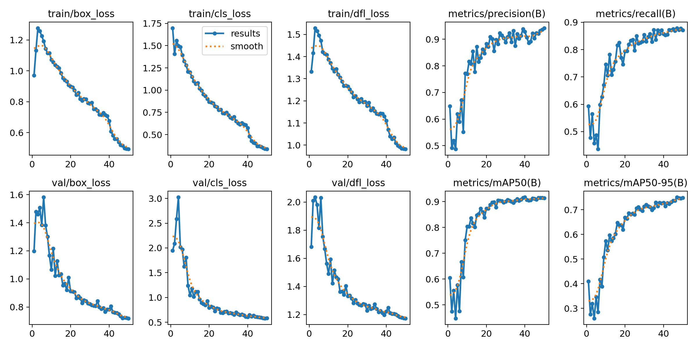
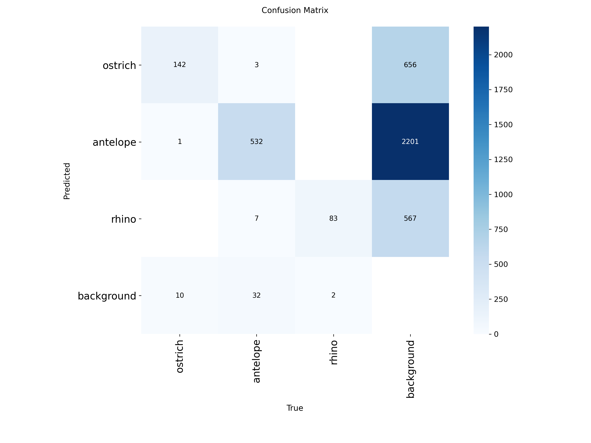

# YOLOv8 기반 사바나 동물 3종 객체 탐지 및 추적

COCO 사전학습 클래스에 없는 타조(ostrich), 영양(antelope), 코뿔소(rhino)를 YOLOv8s로 전이학습하고, 사바나 영상에서 탐지·추적한 프로젝트입니다.

- 과목: 머신러닝 / 이름: 천훈필 / 학번: 2022041077

## 결과 영상
[safari3_tracking.mp4](safari3_tracking.mp4)

## 데이터
| 클래스 | 학습 이미지 | 검증 이미지 | 전체 |
|---|---|---|---|
| ostrich | 314 | 115 | 429 |
| antelope | 401 | 333 | 734 |
| rhino | 400 | 62 | 462 |

- 출처: [Open Images V7](https://storage.googleapis.com/openimages/web/index.html) (이미지 CC BY 2.0, 라벨 CC BY 4.0)

## 학습
- 모델: YOLOv8s (Ultralytics), COCO 사전학습 가중치에서 전이학습
- 50 epochs, 입력 640×640, batch 16
- 환경: Google Colab (NVIDIA Tesla T4)

## 성능 (검증 데이터 508장)
| 클래스 | Precision | Recall | mAP50 | mAP50-95 |
|---|---|---|---|---|
| 전체 | 0.928 | 0.871 | 0.914 | 0.750 |
| ostrich | 0.947 | 0.869 | 0.897 | 0.712 |
| antelope | 0.901 | 0.803 | 0.882 | 0.704 |
| rhino | 0.937 | 0.941 | 0.964 | 0.834 |

## 추적
- 추적기: ByteTrack (신뢰도 임계값 0.3)
- ID별 박스 중심점의 최근 40프레임을 궤적으로 표시
- 같은 추적 ID의 예측을 누적해 가장 많이 나온 클래스로 표시

## 파일
| 파일 | 설명 |
|---|---|
| `best.pt` | 학습된 YOLOv8s 모델 |
| `safari3_tracking.mp4` | 탐지·추적 결과 영상 |
| `safari3_yolo_tracking.ipynb` | 데이터 수집부터 추적까지 전체 코드 (Colab) |
| `results.png`, `confusion_matrix.png` | 학습 곡선, 혼동행렬 |

## 입력 영상 출처
Pexels, "아프리카 사바나의 야생 동물: 타조와 코뿔소" (촬영: Magda Ehlers)  
https://www.pexels.com/ko-kr/video/34746032/
